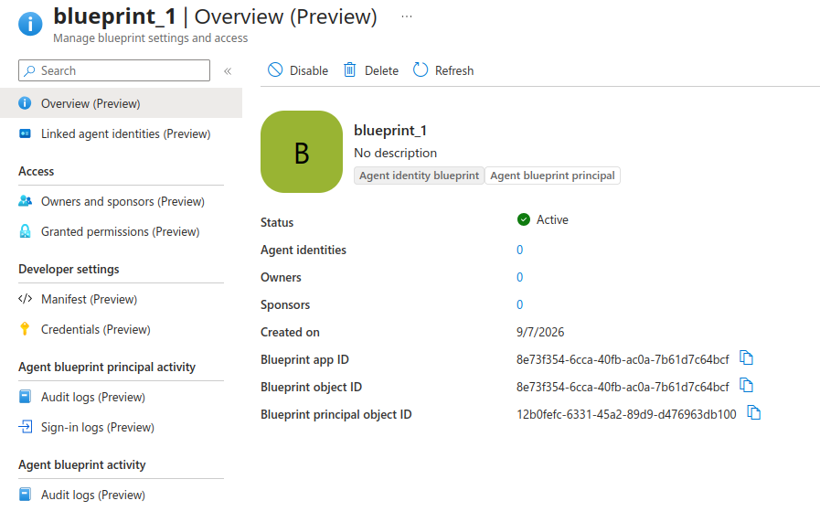
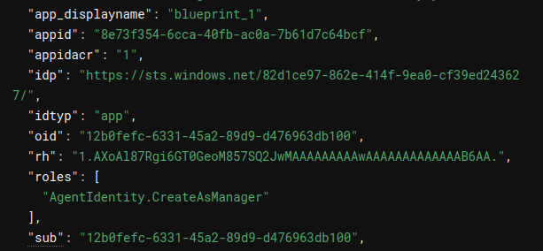
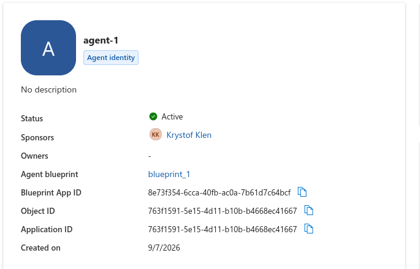
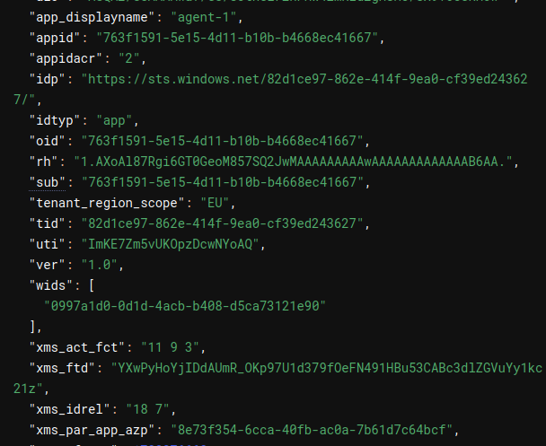
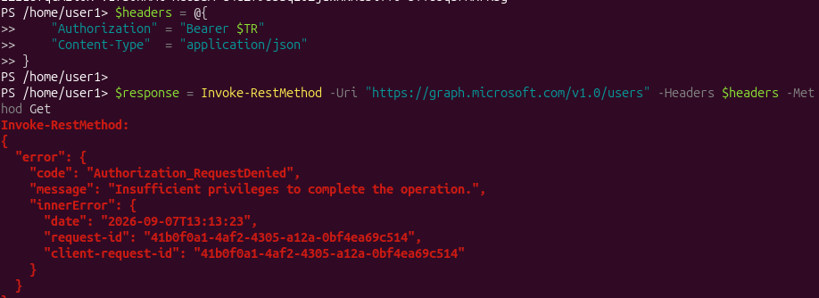
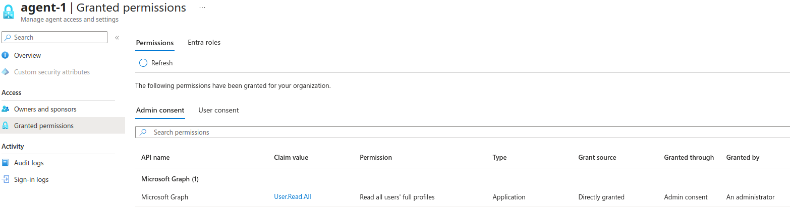
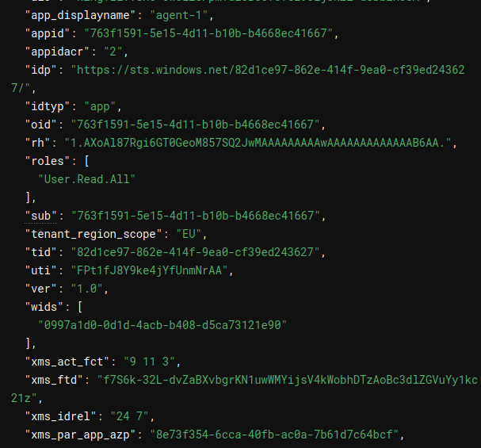
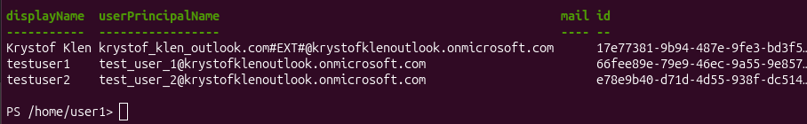

### Create blueprint
``` powershell
$TenantId = "82d1ce97-862e-414f-9ea0-cf39ed243627"
$UserId = "17e77381-9b94-487e-9fe3-bd3f5c1b3424"

Connect-MgGraph -Scopes "AgentIdentityBlueprint.Create","User.Read" -TenantId $TenantId

$body = @{
    "@odata.type" = "#microsoft.graph.agentIdentityBlueprint"
    "displayName" = "blueprint_1"
    "sponsors@odata.bind" = [string[]]@("https://graph.microsoft.com/v1.0/users/$UserId")
    "owners@odata.bind"   = [string[]]@("https://graph.microsoft.com/v1.0/users/$UserId")
} | ConvertTo-Json -Depth 5

$Response = Invoke-MgGraphRequest `
    -Method POST `
    -Uri "https://graph.microsoft.com/v1.0/applications/microsoft.graph.agentIdentityBlueprint" `
    -Headers @{ "OData-Version" = "4.0" } `
    -Body $body `
    -ContentType "application/json"

$BlueprintAppId = $Response.id

```

### Create blueprint principal
```powershell
$Body = @{
    appId   = $BlueprintAppId
}
Invoke-MgGraphRequest -Method POST -Uri "https://graph.microsoft.com/v1.0/serviceprincipals/microsoft.graph.agentIdentityBlueprintPrincipal" -Headers @{ "OData-Version" = "4.0" } -Body ($Body | ConvertTo-Json)
```
In the portal, we can see Agent Blueprint and Agent Blueprint Principal being created.


### Add credential to blueprint
```powershell
Connect-MgGraph -Scopes "Application.ReadWrite.All" -TenantId $TenantId

$secret = Add-MgApplicationPassword -ApplicationId $BlueprintAppId -PasswordCredential @{
    DisplayName = "credential-1"
    EndDateTime = (Get-Date).AddYears(1)
}

$ClientSecret = $secret.SecretText
```
### Sign in with blueprint 
```powershell

$TokenResponse = Invoke-RestMethod -Method POST `
    -Uri "https://login.microsoftonline.com/$TenantId/oauth2/v2.0/token" `
    -ContentType "application/x-www-form-urlencoded" `
    -Body @{
        client_id     = $BlueprintAppId
        scope         = "https://graph.microsoft.com/.default"
        grant_type    = "client_credentials"
        client_secret = $ClientSecret
    }

$AccessToken = $TokenResponse.access_token
``` 
When decoding the jwt token, there are a few claims to note:
- appid: is the ID of App Blueprint 
- roles: Contains Agentdentity.CreateAsManager, this role was included and granted by default, it will allow the Blueprint to create child Agent Identity.
- sub: The subject id the ID of the blueprint principal.




### Create agent identity on behalf of blueprint
```powershell
$Headers = @{
    "Authorization" = "Bearer $AccessToken"
    "OData-Version" = "4.0"
}

$BodyJson = @{
    displayName              = "agent-1"
    agentIdentityBlueprintId = $BlueprintAppId
    "sponsors@odata.bind"    = @(
        "https://graph.microsoft.com/v1.0/users/$UserId"
    )
} | ConvertTo-Json -Depth 5

$Agent = Invoke-RestMethod -Method POST `
    -Uri "https://graph.microsoft.com/beta/servicePrincipals/Microsoft.Graph.AgentIdentity" `
    -Headers $Headers `
    -ContentType "application/json" `
    -Body $BodyJson

$AgentIdentityAppId = $Agent.id
    
```
We can now see the Agent Identity in the entra portal, referencing the previously created blueprint.



### Add Roles and Delegated scopes into Required resources
```powershell
$TargetApiAppId    = "00000003-0000-0000-c000-000000000000" # ID of Microsoft Graph

$Body = @(
    @{
        resourceAppId  = $TargetApiAppId
        resourceAccess = @(
            # --- 4 App Roles (type = "Role") ---
            @{ id = "df021288-bdef-4463-88db-98f22de89214"; type = "Role" },  # User.Read.All

            # --- 4 Delegated Scopes (type = "Scope") ---
            @{ id = "bc024368-1153-4739-b217-4326f2e966d0"; type = "Scope" }, # GroupMember.Read.All
            @{ id = "570282fd-fa5c-430d-a7fd-fc8dc98a9dca"; type = "Scope"} # Mail.Read
        )
    }
)

Update-MgApplication -ApplicationId $BlueprintAppId -RequiredResourceAccess $Body
```

### Add inheritable permissions
```powershell

$Body = @{
    resourceAppId     = $TargetApiAppId
    inheritableScopes = @{
        "@odata.type" = "#microsoft.graph.enumeratedScopes"
        scopes        = @(
            "bc024368-1153-4739-b217-4326f2e966d0",  # User.Read.All
            "570282fd-fa5c-430d-a7fd-fc8dc98a9dca"   # Mail.Read
        )
    }
    inheritableRoles  = @{
        "@odata.type" = "#microsoft.graph.allAllowedRoles" # User.Read.All
    }
}

$InheritBody = $Body | ConvertTo-Json -Depth 5

$Uri = "https://graph.microsoft.com/beta/applications/microsoft.graph.agentIdentityBlueprint/$BlueprintAppId/inheritablePermissions/$TargetApiAppId"

Invoke-MgGraphRequest `
  -Method POST `
  -Uri $Uri `
  -Headers @{ "OData-Version" = "4.0"; "Content-Type" = "application/json" } `
  -Body $InheritBody
  ``
```
See the result: 
```powershell
$Uri = "https://graph.microsoft.com/beta/applications/microsoft.graph.agentIdentityBlueprint/$BlueprintAppId/inheritablePermissions"
(Invoke-MgGraphRequest -Method GET -Uri $Uri).value | ConvertTo-Json -Depth 5
```

### Authenticate with blueprint to get T1
```powershell
Add-Type -AssemblyName System.Web

$TokenEndpoint = "https://login.microsoftonline.com/$TenantId/oauth2/v2.0/token"
          
$T1Body = "client_id=$BlueprintAppId" +
          "&scope=api://AzureADTokenExchange/.default" +
          "&grant_type=client_credentials" +
          "&client_secret=$([System.Web.HttpUtility]::UrlEncode($ClientSecret))" +
          "&fmi_path=$AgentIdentityAppId"

$T1Response = Invoke-RestMethod `
    -Method POST `
    -Uri $TokenEndpoint `
    -ContentType "application/x-www-form-urlencoded" `
    -Body $T1Body

$T1 = $T1Response.access_token
```

Notable claims:
- aud
- azp
- sub
- xms_par_app_azp

### Use T1 to get TR

```powershell
$TRBody = "client_id=$AgentIdentityAppId" +
          "&scope=$TargetApiAppId/.default" +
          "&grant_type=client_credentials" +
          "&client_assertion_type=urn:ietf:params:oauth:client-assertion-type:jwt-bearer" +
          "&client_assertion=$T1" +
          "&token_exchange_type=urn:ietf:params:oauth:token-type:jwt" +
          "&assertion=$T1"

$TRResponse = Invoke-RestMethod `
    -Method POST `
    -Uri $TokenEndpoint `
    -ContentType "application/x-www-form-urlencoded" `
    -Body $TRBody

$TR = $TRResponse.access_token
```

### See on try TR
- no scopes, no roles because missing admin consent

- If we now try User.Read.All, we will get authorization error, because the required role is missing in our token, to add the role to our token, we will need to do admin consent on User.Read.All on the Agent Identity, because this is Application Scope and Application Scopes require admin consent on permissions.


### Admin consent
```powershell
Connect-MgGraph -TenantId $TenantId -Scopes "AppRoleAssignment.ReadWrite.All"

$AgentSP     = Get-MgServicePrincipal -Filter "appId eq '$AgentIdentityAppId'"
$TargetApiSP = Get-MgServicePrincipal -Filter "appId eq '$TargetApiAppId'"

$UserReadAll = $TargetApiSP.AppRoles | Where-Object { $_.Value -eq "User.Read.All" }

New-MgServicePrincipalAppRoleAssignment `
    -ServicePrincipalId $AgentSP.Id `
    -PrincipalId $AgentSP.Id `
    -ResourceId $TargetApiSP.Id `
    -AppRoleId $UserReadAll.Id
```
Now we can see in the portal that the role has been grantd.


### Recreate TR and see roles 

```powershell
$TRResponse = Invoke-RestMethod `
    -Method POST `
    -Uri $TokenEndpoint `
    -ContentType "application/x-www-form-urlencoded" `
    -Body $TRBody

$TR = $TRResponse.access_token
```
We ca see that now the token also contains "roles" claim where User.Read.All is included.


### Test the token
```powershell
$headers = @{
    "Authorization" = "Bearer $TR"
    "Content-Type"  = "application/json"
}

$response = Invoke-RestMethod -Uri "https://graph.microsoft.com/v1.0/users" -Headers $headers -Method Get

# Display the users
$response.value | Select-Object displayName, userPrincipalName, mail, id
```

We can see that it's working. We've successfully retrieved user information through MS Graph with Agent Identity.


### See logs